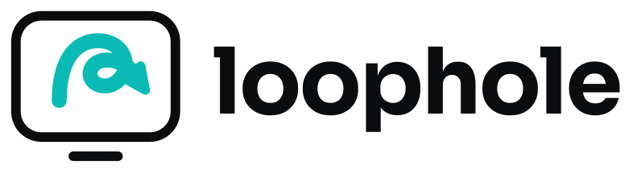
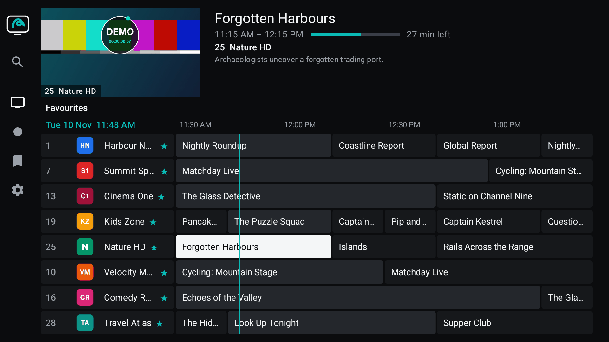
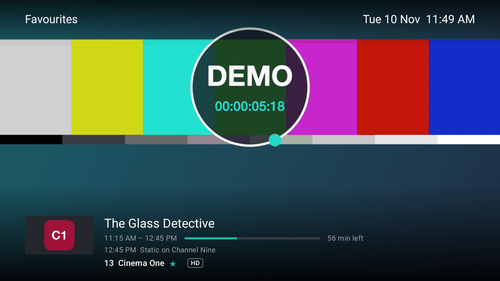
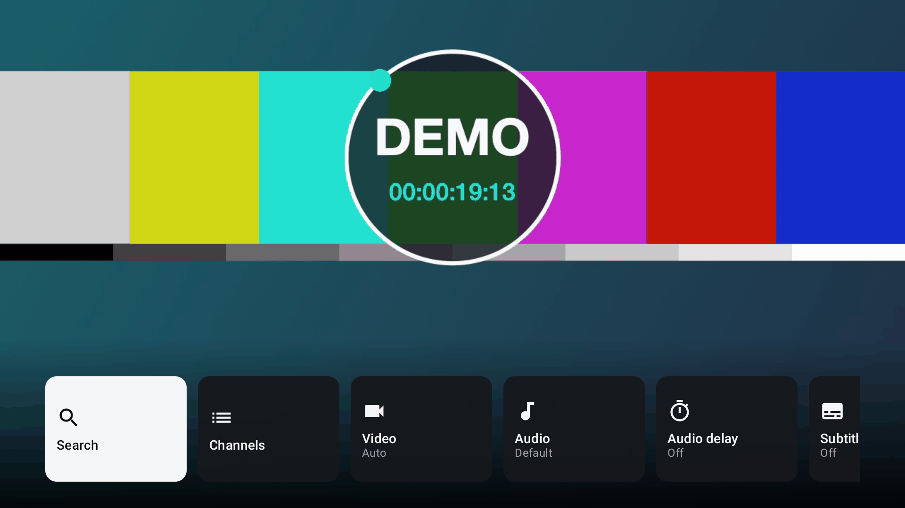
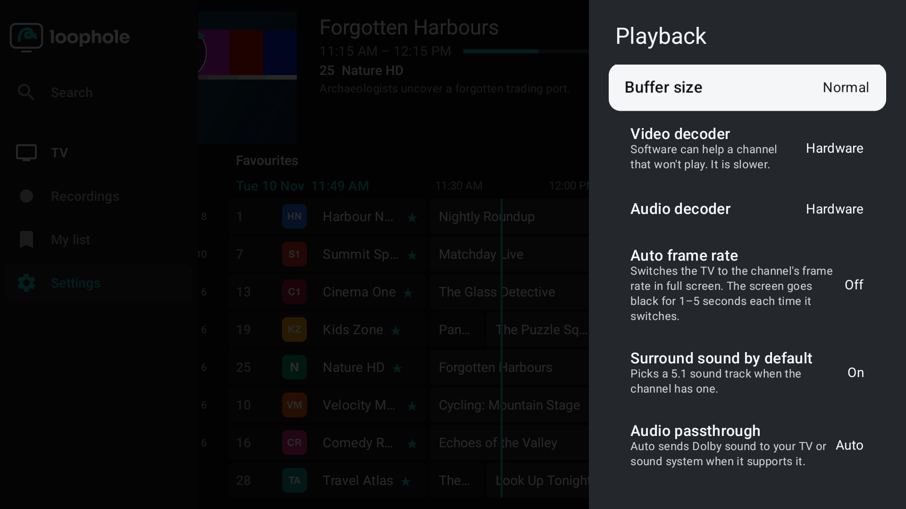
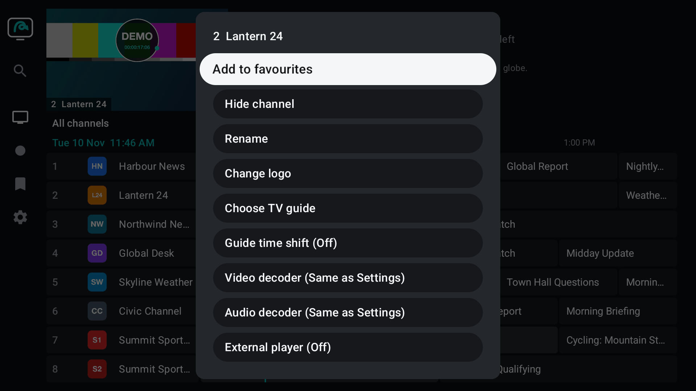
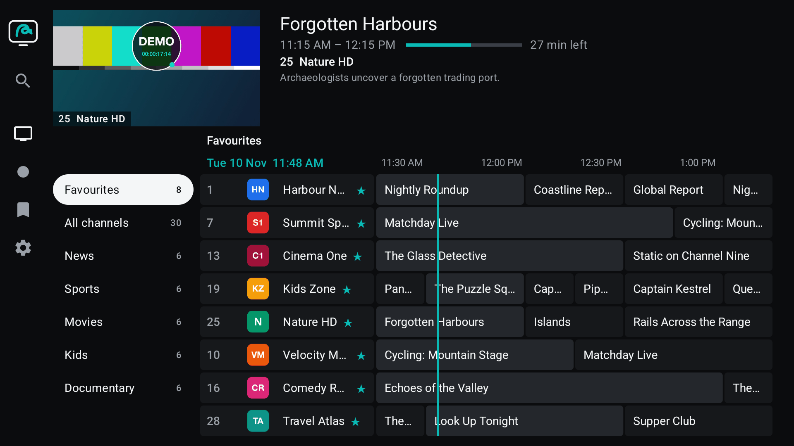
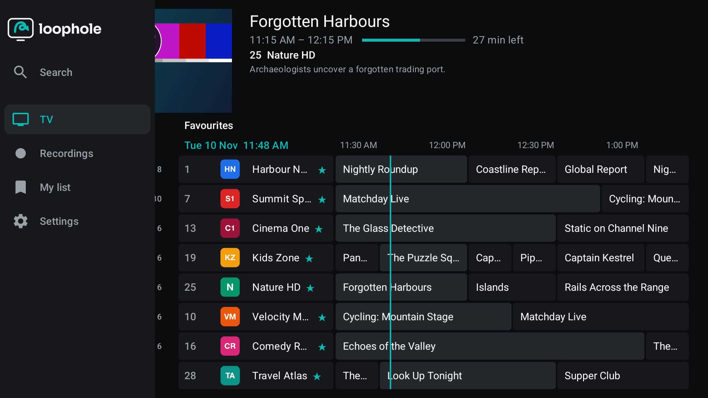
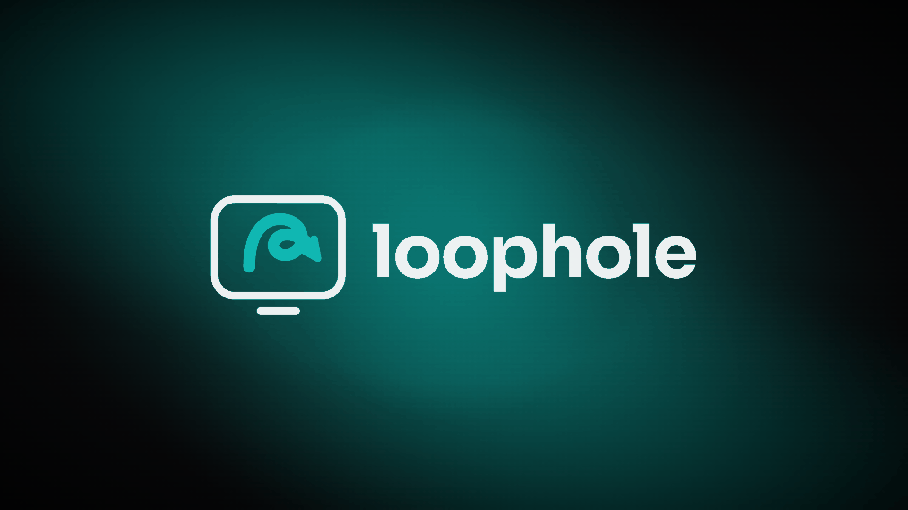

<p align="center">
  <picture>
    <source media="(prefers-color-scheme: dark)" srcset="docs/brand/loophole-logo-dark.png">
    <source media="(prefers-color-scheme: light)" srcset="docs/brand/loophole-logo-light.png">
    
  </picture>
</p>

<p align="center">
  <strong>An open-source IPTV player for Android TV, Google TV and Fire TV, made for the remote.</strong>
</p>

<p align="center">
  <a href="LICENSE"></a>
  <a href="https://github.com/loopholetv/loophole/releases/latest"></a>
  
  
</p>

> [!IMPORTANT]
> **Loophole is a player only. It contains no channels.** Add the playlist from your own IPTV subscription.

Loophole plays live channels and a programme guide from the playlists you give it: an M3U link, a local M3U file, an Xtream Codes account or a MAC (Stalker) portal, with XMLTV guides. It is written in Kotlin with Compose for TV and Media3.

## Screenshots

<table>
  <tr>
    <td width="50%"></td>
    <td width="50%"></td>
  </tr>
  <tr>
    <td align="center"><sub>TV guide with live preview and programme details</sub></td>
    <td align="center"><sub>Full screen with the info bar</sub></td>
  </tr>
  <tr>
    <td></td>
    <td></td>
  </tr>
  <tr>
    <td align="center"><sub>Quick menu while watching</sub></td>
    <td align="center"><sub>Settings → Playback</sub></td>
  </tr>
  <tr>
    <td></td>
    <td></td>
  </tr>
  <tr>
    <td align="center"><sub>Channel options</sub></td>
    <td align="center"><sub>Groups</sub></td>
  </tr>
  <tr>
    <td></td>
    <td></td>
  </tr>
  <tr>
    <td align="center"><sub>Side menu</sub></td>
    <td align="center"><sub>Splash</sub></td>
  </tr>
</table>

<sub>Screenshots use a made-up demo playlist, guide and test signal. Every channel, programme and logo in them is fictional.</sub>

## Features

### Playlists & guide

- **Four kinds of playlist:** M3U link, local M3U file, Xtream Codes account or MAC (Stalker) portal, each with an XMLTV programme guide.
- **TV guide with a live preview:** the channel you pick plays in a small window above the grid, next to the programme's title, time, progress and description.
- **Several playlists:** Settings → Playlists → *Add playlist*. Each playlist can be turned off, renamed, given another address or login, and have its own user agent and update schedule. Update one on its own or all of them with *Update all playlists*. Channel numbers continue from one playlist to the next.
- **Guides per playlist:** Settings → EPG lists each playlist's own guide (which you can turn off) and any extra guide links you add. You choose how many past days to keep (*Automatic* keeps as many as your channels' catch-up goes back, up to a week), and can clear the guide.
- **Scheduled updates:** playlists and guides update on a schedule and at app start, and the guide can also update after each playlist update.
- **Search:** find channels and programmes from the side menu, with the on-screen keyboard or voice where the TV offers it.

<details>
<summary><strong>Local playlist files</strong></summary>

Choose *Local file* in the playlist form. Loophole uses the TV's own file picker when it has a real one, otherwise its own simple browser: the Download folder, USB drives, and a *Loophole folder* that always works (copy the file into `Android/data/io.github.loopholetv/files/` with a file manager or adb). *Update playlist* reads the file again. If the file or the USB drive is missing, the channels stay and Settings says which copy is in use.

</details>

<details>
<summary><strong>MAC portals</strong></summary>

Enter the portal address and the MAC address your provider registered (usually starting `00:1A:79:`), plus the login and device details only if your provider gave them. A portal account usually allows one device at a time.

</details>

### Watching

- **Full screen with an info bar:** now and next, time left, and a row of channels to flip through without leaving the picture.
- **Catch-up TV:** on channels your provider records, a rewind icon marks them in the guide and Left walks back into finished programmes, as far as the channel's archive goes. OK on one plays it from the start in full screen; when it ends, the next one starts. Works with Xtream Codes accounts (`tv_archive`) and with M3U playlists that declare catch-up (`catchup="default"`, `"append"`, `"shift"`, `"flussonic"` or `"xc"`, with `catchup-source` and `catchup-days`). MAC (Stalker) portals have no catch-up yet.
- **Seek bar:** while a programme plays back, Rewind and Fast-forward jump 10 and 30 seconds (hold them to go faster; the picture moves once you let go), Play/Pause pauses, and the bar shows the title, times, elapsed and total time. *Live* (or fast-forwarding to the end) returns to the live channel. *Watch from start* in the quick menu restarts the current programme.
- **Rewind and pause live TV:** on a catch-up channel, Rewind goes back from live and Pause holds the picture; Play carries on from where you paused. On a channel without catch-up, Loophole says so.
- **Quick menu:** press ≡ or hold OK while watching for Search, Channels, Video quality, Audio track, Audio delay, Subtitles, Aspect ratio, Sleep timer, Add to favourites, Cast to all TVs, Channel options, Picture-in-picture (where the TV supports it) and Settings.
- **History:** channels you watched for 10 seconds or more, newest first, from the History tile in the full-screen overlay.
- **Sleep timer:** 15 minutes to 2 hours, with a warning before it stops.
- **Picture-in-picture:** on TVs that support it, from the quick menu or (if you turn it on) the Home button. Closing the small window stops the stream. Fire TV devices usually don't offer it, and then it isn't shown.
- **Cast to other TVs:** one TV shares what it's playing with the other Loophole TVs on your home network, using a single connection to your provider. Choose *Cast to all TVs* in the quick menu: TVs with nothing playing join by themselves, and a TV that is playing something gets a short prompt. Back on a following TV leaves the cast, and *TVs* in the side menu lists the other TVs and lets it join again. Each TV takes part only while Loophole is open on it. To stop a TV joining by itself, turn off Settings → General → *Allow other TVs to cast to this TV*.
- **External players:** a channel can open in MX Player, VLC, Kodi or Just Player when they're installed, or ask each time. Loophole stops its own stream first, so a one-connection account isn't used twice.
- **Start and exit:** optionally reopen the last channel on start, and optionally confirm before Back leaves the app.

### Remote control

- **Settings → Remote control:** four switches choose whether Rewind/Fast-forward/Pause seek in catch-up, whether Rewind goes back from live, whether Left/Right seek when the controls are hidden, and whether Left goes back from live.
- **Your own buttons:** map any spare remote button (a colour key, for example) to an action in the player (channel up/down, channel list, TV guide, quick menu, favourite, subtitles, audio track, sleep timer, search, play/pause, rewind, fast-forward, live, watch from start) or in the guide (page up/down, back to now, previous/next day, favourite, search, Settings). *Reset buttons* puts them back.
- **Defaults:** CH+/CH− (or Page up/down) change channel full screen and page the guide; Rewind/Fast-forward move the guide a day. D-pad Up and Down never change channel full screen.

### Playback & sound

- **Settings → Playback:** buffer size (Small, Normal, Large), hardware or software video and audio decoders, auto frame rate, surround sound by default, audio passthrough, DTS to PCM, audio delay, preferred audio and subtitle languages, subtitle size, colour, background and edge, and tunneled playback.
- **Audio delay (lip-sync):** −1000 to +1000 ms, from Settings or the quick menu.
- **Aspect ratio:** Fit, Stretch, Zoom, 16:9 or 4:3, remembered per channel.
- **Per-channel playback:** a channel can have its own video decoder, audio decoder and external player.
- **Extra audio formats:** built-in software decoders for MP2, AC3/E-AC3 and DTS sound, used only when the TV's own decoders can't play a channel's audio.
- **Network:** a user agent for every playlist, and a UDP proxy (udpxy-style) for multicast playlists.

### Organising channels

- **Favourites:** hold OK (or press ≡) on a channel → *Channel options* → *Add to favourites*. Favourites is the first group in the guide, and you can reorder it with *Move*.
- **Channel and group edits:** hide, rename (and restore the original name), move, sort a group, change a channel's logo with an image link, choose its TV guide channel and shift its guide time. Do it from the guide or from Settings → Playlists → (playlist) → *Groups and channels*.
- **Edits survive updates:** your changes stay when the playlist updates, and hidden channels and groups come back from *Groups and channels*.

### Private by design

- No analytics, crash reporting or ads.
- Network requests go only to the playlist, guide, logo and stream addresses you supply, and, for casting, to other Loophole TVs on your home network.

## Install

Loophole isn't in any app store. Download the latest `loophole-<version>.apk` from the [Releases page](https://github.com/loopholetv/loophole/releases/latest) and sideload it.

> [!TIP]
> **Quickest way on a TV:** in the **Downloader** app, enter code **`8595455`**. It always downloads the latest release. Or use the link [aftv.news/8595455](http://aftv.news/8595455), or the direct download [`releases/latest/download/loophole.apk`](https://github.com/loopholetv/loophole/releases/latest/download/loophole.apk).

### Fire TV (Fire TV Stick, Fire TV Cube)

1. Settings → My Fire TV → Developer options: turn on *Apps from Unknown Sources* (or allow the Downloader app to install apps).
2. Install the **Downloader** app from the Amazon Appstore.
3. In Downloader, type the code **`8595455`** and press **Go**. Choose *Install* when the download finishes. The code always fetches the latest release.

### Android TV and Google TV

- **With a computer on the same network:** turn on *Developer options → USB/Network debugging* on the TV, then run:

  ```sh
  adb connect <tv-ip>:5555
  adb install loophole-<version>.apk
  ```

- **With the Downloader app** (from Google Play): enter code `8595455`, then allow Downloader to install apps when asked.
- **Without a computer:** copy the APK to the TV (on a USB drive or through a cloud drive) and open it with a file manager app, allowing that app to install unknown apps when asked.

### Optional: a smoother first run

After sideloading with adb, you can ask Android to compile the app ahead of time. Otherwise this happens gradually over the first few days.

```sh
adb shell cmd package compile -m speed-profile -f io.github.loopholetv
```

## Updating

From 0.4.1, Loophole checks for new releases by itself, at most once a day. When one is available, a small card on the guide offers it: choose **Update**, and Android asks you to confirm the install. The first time, Android asks you to allow Loophole to install apps. You can turn the check off in **Settings → General**, or check now from **Settings → About**.

You can also install a new APK over the old one by hand, the same way as above. Either way, your playlists and settings are kept.

Every release is signed with the same key. If Android refuses to update ("App not installed" or a signature conflict), the installed copy came from a different source. Uninstall it first, which removes its data, then install the new APK.

## Building from source

You need JDK 17 and the Android SDK (set `sdk.dir` in `local.properties` or `ANDROID_HOME`).

```sh
./gradlew assembleDebug      # debug build
./gradlew assembleRelease    # release build (R8)
./gradlew test               # unit tests
```

Release signing reads a `keystore.properties` file (`storeFile`, `storePassword`, `keyAlias`, `keyPassword`) from the path in the Gradle property `loophole.signing`, else the environment variable `LOOPHOLE_SIGNING_PROPERTIES`, else `~/.loophole-signing/keystore.properties`. Without it, the release APK is built unsigned and Gradle prints a warning. Keystores and signing properties are never committed.

## Privacy

Loophole has no analytics, crash reporting or ads, and no account of its own. The only network requests it makes are to the playlist, guide, logo and stream URLs you supply. When casting, Loophole talks to other Loophole TVs on your home network and never sends them playlist links or logins. Playlist URLs and credentials are redacted from logs and error messages.

## Licence & third-party notices

Loophole is free software, licensed under the [GNU General Public License v3.0](LICENSE).

It bundles the FFmpeg audio decoder for Media3 built by the Jellyfin project ([jellyfin-androidx-media](https://github.com/jellyfin/jellyfin-androidx-media)), which contains code from [FFmpeg](https://ffmpeg.org) and is licensed under GPL-3.0. Its source code is available from that repository and from FFmpeg. [NOTICE](NOTICE) lists this and the other third-party components and their licences.

## Contributing

Bug reports and pull requests are welcome. Please keep pull requests focused, run `./gradlew test` before opening one, and describe how you tested the change on a TV or emulator. By contributing, you agree that your work is licensed under GPL-3.0.

Please don't post playlist links, logins or screenshots of real subscriptions in issues.
